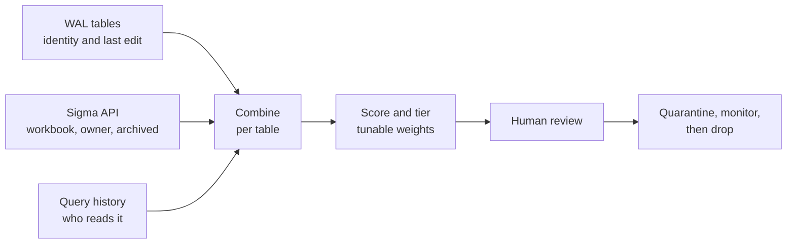
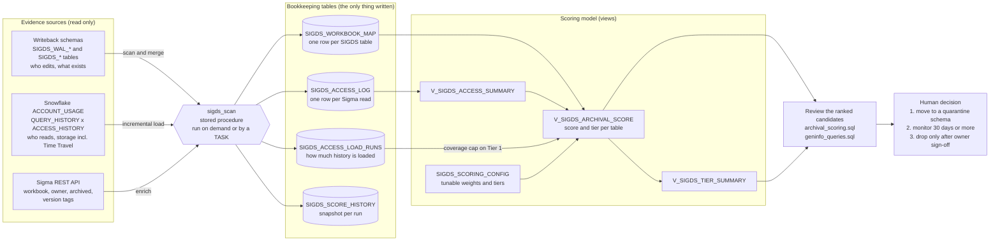
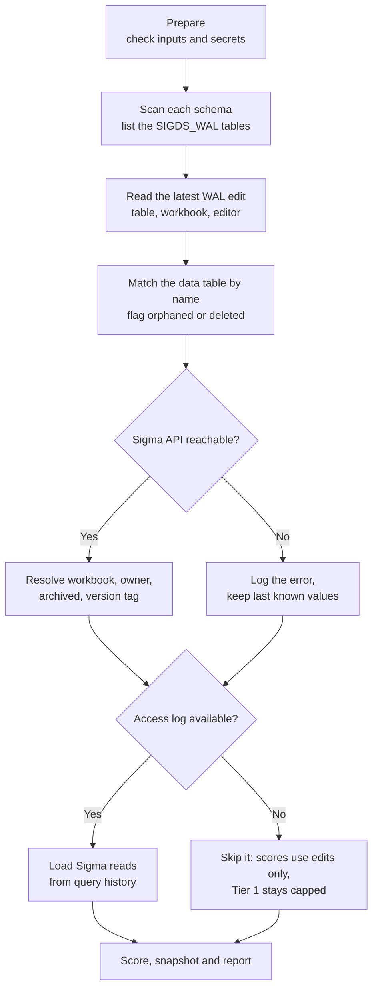
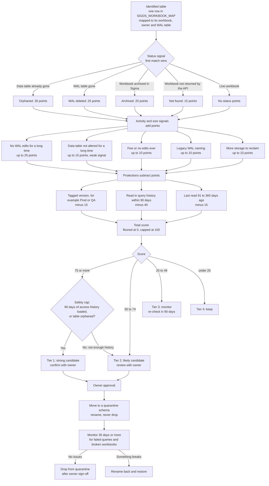

# writeback_info_sf

> **Preview.** A read-only, unofficial toolkit. Try it first on a non-critical schema and review the output before acting on it. It has been exercised end to end on one Snowflake Enterprise Edition account, so behaviour on other accounts, editions and writeback volumes may differ.

> **Personal project.** This is my own work, shared as a reference. I work at Sigma Computing, but this is not an official Sigma product and Sigma does not support it. It is provided as-is, without warranty, so try it on a non-critical schema first. For official Sigma tooling and support, see [Sigma's documentation](https://help.sigmacomputing.com).

## Background

Sigma input tables let people enter and edit data directly in a workbook. Sigma writes that data to [designated write schemas that your data platform admin configures](https://help.sigmacomputing.com/docs/intro-to-input-tables), so it stays in your own data platform. You can create warehouse views over input tables, and Sigma [automatically creates a warehouse view of each input table's row-level and schema history](https://help.sigmacomputing.com/docs/view-input-table-audit-history). For each input table Sigma also keeps an edit log (a write-ahead log, or WAL) [for durability, consistency and recovery](https://help.sigmacomputing.com/docs/intro-to-input-tables). Sigma [reserves the schema for its writeback objects](https://help.sigmacomputing.com/docs/connect-to-snowflake), and the documentation [advises using a dedicated database or schema](https://help.sigmacomputing.com/docs/connect-to-snowflake) that does not hold data used for analysis and reports. Besides input tables and their edit logs, a writeback schema can also hold [warehouse views, materializations, CSV uploads and Sigma Assistant usage data](https://help.sigmacomputing.com/docs/connect-to-snowflake).

This design leaves control with you. Deleting an input table element in a workbook [does not delete its data from your platform](https://help.sigmacomputing.com/docs/intro-to-input-tables); you remove it there, if and when you choose. Some workflows, including [duplicating a workbook, creating a tagged version, restoring a workbook version and swapping the input table connection](https://help.sigmacomputing.com/docs/view-input-table-audit-history), replace the input table with a copy that has a new input table ID. The tables themselves carry the documented [`SIGDS_` prefix](https://help.sigmacomputing.com/docs/intro-to-input-tables) followed by an ID rather than a workbook name (observed naming, which may change). So a long-lived schema naturally grows, and the link from a table back to its workbook has to be looked up.

Admins who want to tidy up need three answers before touching anything: whose is it, is anyone still using it, and what would it free up? Those answers live in three places: the WAL (identity and edits), the Sigma API (owner and state) and warehouse query history (reads). This toolkit brings them together, read-only, so decisions are made with evidence. It complements Sigma's input table audit history and does not replace it.

## An approach

One way to solve this is to gather three independent kinds of evidence for each table, score them in the open, and keep a person in the loop.



1. **Identity from the WAL.** Each WAL record's metadata carries the data table name, the Sigma workbook, the input table name and the last editor, so it ties a table name to its workbook.
2. **Ownership and state from the Sigma API.** The workbook list shows each workbook's owner and whether it is archived. A workbook missing from the list may have been deleted, but that is a signal rather than proof.
3. **Usage from warehouse query history.** In testing, queries that Sigma generates carried a trailing JSON comment with the workbook URL and the user (observed; not a documented interface, so the format may change). That lets reads of a writeback table be attributed to a workbook and user, which catches tables that are read but never edited.
4. **Score, then decide.** Combine the evidence into a tunable score and tier. Nothing is removed automatically: candidates are moved to a quarantine schema, watched for a period, and dropped only after the owner agrees.

> **About the WAL.** The toolkit reads WAL metadata read-only, and only to map table names to workbooks. The WAL is not a documented customer interface and its layout can change: it has already moved from one log per connection to one per input table ([Sigma's announcement](https://community.sigmacomputing.com/t/improving-how-your-input-tables-work-introducing-multiwal/6391)). It is not a basis for audit or compliance. Sigma describes the WAL as [not designed for customer use](https://community.sigmacomputing.com/t/improving-how-your-input-tables-work-introducing-multiwal/6391) and says using it [for audit or compliance is no longer recommended or supported](https://community.sigmacomputing.com/t/how-to-use-the-wal-for-global-input-table-audit-logging/2622). The [Sigma audit log](https://help.sigmacomputing.com/docs/enable-audit-logging) is the route for that, and [input table audit history](https://help.sigmacomputing.com/docs/view-input-table-audit-history) shows row-level and schema history.

Principles that keep it safe:
- **Read-only.** The analysis never changes a writeback table.
- **Reads protect.** Recent reads reduce a table's score, even when nothing has edited it. Edits are only half of "in use".
- **Absence of evidence is not proof.** No access seen only removes a protection. It never proves a table is unused.
- **Archived or deleted is a signal, not proof.** Workbooks and versions can be [recovered](https://help.sigmacomputing.com/docs/recover-deleted-documents) or [restored](https://help.sigmacomputing.com/docs/workbook-versions-and-version-history).
- **The weights are opinions.** Thresholds differ between customers, so they are configuration, not code.

## This project

A standalone, **read-only information tool** for Sigma writeback (input table) estates on Snowflake. It runs **entirely inside Snowflake** as a stored procedure — call it from a Snowsight worksheet or notebook, or schedule it with a task; nothing runs on your machine. It answers three questions about every `SIGDS_*` table:

1. **Whose is it?** — maps each WAL / data table to its Sigma workbook or data model, owner, folder, and archived / deleted state.
2. **Is anyone using it?** — combines the WAL (who *edits*) with Snowflake query history (who *reads*), so a table that is read all day but never edited is not mistaken for an inactive one.
3. **What could be reclaimed?** — a transparent, tunable score and tier per table, plus reclaimable storage including Time Travel / Fail-safe.

It never drops, renames, or alters writeback tables. It does not depend on any other toolkit. The only elevated step is a **one-time ACCOUNTADMIN setup** (a network rule, secrets and an external access integration), which is what lets a Snowflake procedure call the Sigma API.

**Scope.** It covers input-table objects only: `SIGDS_*` data tables and `SIGDS_WAL*` edit logs. Other objects that can live in a writeback schema, such as the `INPUT_TABLE_AUDIT_LOG_*` views, other warehouse views, materializations and CSV uploads, are ignored.

### How it fits together



Reading it left to right: the scan gathers three kinds of evidence (edits, reads and Sigma metadata) into a handful of bookkeeping tables. The scoring views combine them under one set of tunable weights. Nothing in the pipeline changes a writeback table: any quarantine or drop is a separate, manual step taken by a person after reviewing the output.

### The scan at a glance

What `sigds_scan` does each time it runs. [What the scan does, in detail](#what-the-scan-does-in-detail) explains each step, and the [Decision logic](#decision-logic) diagram expands the final scoring step.



## Files

Run them in this order, once; then just `CALL sigds_scan(...)` on a schedule.

| # | File | Purpose |
|---|---|---|
| 1 | `setup_prerequisites.sql` | **ACCOUNTADMIN, once.** Network rule (your Sigma host only), secrets for the Sigma URL + credentials, external access integration, grants. |
| 2 | `create_sigds_workbook_map.sql` | DDL: `SIGDS_WORKBOOK_MAP`, `SIGDS_ACCESS_LOG`, `SIGDS_ACCESS_LOAD_RUNS`, `SIGDS_SCORE_HISTORY`. Idempotent; upgrades pre-v2 maps in place. |
| 3 | `scoring_views.sql` | The scoring model, in **one place**: `SIGDS_SCORING_CONFIG` (tunable weights), `V_SIGDS_ACCESS_SUMMARY`, `V_SIGDS_ARCHIVAL_SCORE`, `V_SIGDS_TIER_SUMMARY`. Re-running keeps your config tuning. |
| 4 | `sigds_scan_procedure.sql` | The scan itself: `sigds_scan(...)` Python stored procedure, plus an example `TASK`. |
| — | `archival_scoring.sql` | Read-only queries over the scoring views, plus the safe-deletion procedure. |
| — | `geninfo_queries.sql` | Exploratory reports: landscape, reclamation, staleness, owners, multi-table workbooks, legacy WALs, read-only consumers, tier movement, quarantine watch. |

---

## Setup (once)

### Prerequisites

- A Snowflake database and schema to hold the tool's tables and procedure (the **map schema**). They must already exist. The role that will own the procedure (`<YOUR_ROLE>` below, e.g. `SYSADMIN`) needs `USAGE`, `CREATE TABLE`, `CREATE VIEW` and `CREATE PROCEDURE` on that schema.
- Access to `ACCOUNTADMIN` for step 1 only.
- A Sigma API client credential that can use the org-wide workbook list (`skipPermissionCheck`). The [API reference](https://help.sigmacomputing.com/reference/listworkbooks) says that option is only available to Sigma admins. Create one under *Administration → Developer Access → Create New* (the secret is shown once). Without it, "workbook not found" cannot be trusted and the tool turns that signal off for the run. [Docs](https://help.sigmacomputing.com/reference/generate-client-credentials).
- **Recommended — for access evidence:** Snowflake **Enterprise Edition** or higher. Step 1 grants `IMPORTED PRIVILEGES ON DATABASE SNOWFLAKE` to your role, which unlocks `ACCOUNT_USAGE.ACCESS_HISTORY` / `QUERY_HISTORY` (who reads and writes each table) and `TABLE_STORAGE_METRICS` (Time Travel / Fail-safe bytes). Without it the tool still works, but scores reflect **writes only** and nothing can reach TIER 1 (see [Access evidence](#access-evidence-and-the-safety-cap)).

### Your Sigma API host

| Cloud / Region | Host (no `https://`) |
|---|---|
| AWS-US (West) | `aws-api.sigmacomputing.com` |
| AWS-US (East) | `api.us-a.aws.sigmacomputing.com` |
| AWS-CA | `api.ca.aws.sigmacomputing.com` |
| AWS-EU | `api.eu.aws.sigmacomputing.com` |
| AWS-UK | `api.uk.aws.sigmacomputing.com` |
| AWS-AU | `api.au.aws.sigmacomputing.com` |
| AWS-IN | `api.in.aws.sigmacomputing.com` |
| AWS-CH | `api.ch.aws.sigmacomputing.com` |
| Azure-US | `api.us.azure.sigmacomputing.com` |
| Azure-EU | `api.eu.azure.sigmacomputing.com` |
| Azure-CA | `api.ca.azure.sigmacomputing.com` |
| Azure-UK | `api.uk.azure.sigmacomputing.com` |
| Azure-AU | `api.au.azure.sigmacomputing.com` |
| GCP | `api.sigmacomputing.com` |
| GCP-UK | `api.uk.gcp.sigmacomputing.com` |

Source: [Get started with the Sigma API](https://help.sigmacomputing.com/reference/get-started-sigma-api). That page also shows your base URL under *Administration → Developer Access*. If it differs from this table, use the page.

### How credentials are handled

The Sigma API credential is held in **Snowflake secrets**, never in the code.

- **Three secrets:** `sigds_sigma_base_url`, `sigds_sigma_client_id` and `sigds_sigma_client_secret` (type `GENERIC_STRING`). Step 1 of the deploy below creates them.
- **Nothing sensitive in this repository.** The SQL files contain placeholders only (`<YOUR_SIGMA_CLIENT_ID>` and so on). The real values exist only in your Snowflake account, so you will not find them on GitHub.
- **How the procedure uses them.** `sigds_scan` is bound to the three secrets in its `CREATE PROCEDURE` statement and reads them at run time through Snowflake's secret API. They are not passed as parameters and do not appear in the procedure source, in task definitions or in the run log.
- **Where it can connect.** The procedure can only reach Sigma through the external access integration, and its network rule allows the single host you enter in step 1.
- **Who can use them.** The role that calls the procedure needs `USAGE` on the integration and `READ` on each secret. Snowflake does not return a secret's value through SQL, so having that access does not let someone read the credential back.

Things to be aware of:
- `CREATE SECRET` and `ALTER SECRET` record the statement text, including the value, in Snowflake's query history. Treat the credential as exposed to anyone who can read your account's query history, and rotate it afterwards if that matters.
- Use a dedicated Sigma API client for this tool, that can use the org-wide workbook list (see Prerequisites), and revoke it in Sigma when you stop using the tool.
- To rotate or replace a value later, run `ALTER SECRET <db>.<schema>.sigds_sigma_client_secret SET SECRET_STRING = '<new value>';` as the secret's owner. No change to the procedure is needed.
- To reuse an integration and secrets you already have, see "Reusing an existing integration" at the bottom of `setup_prerequisites.sql`.

### Deploy — in a Snowsight worksheet

For each of the four files: open it, **find & replace** the placeholders, paste into a Snowsight worksheet, and **Run All**. (Snowsight: Cmd/Ctrl+F opens find, with a replace option.)

| Placeholder | Meaning | Files |
|---|---|---|
| `<YOUR_DATABASE>` | Database holding the tool's tables + procedure | 1, 2, 3, 4 |
| `<YOUR_SCHEMA>` | The map schema | 1, 2, 3, 4 |
| `<YOUR_ROLE>` | Role that will own and run the procedure | 1 |
| `<YOUR_SIGMA_API_HOST>` | From the table above | 1 |
| `<YOUR_SIGMA_CLIENT_ID>` / `<YOUR_SIGMA_CLIENT_SECRET>` | Sigma API credential | 1 |
| `<YOUR_WAREHOUSE>` | Only if you enable the example `TASK` | 4 |

1. **`setup_prerequisites.sql`** — runs as `ACCOUNTADMIN` (the file switches role itself). Also uncomment and edit the writeback-schema `GRANT`s at the bottom so your role can read the schema(s) you'll scan.
2. **`create_sigds_workbook_map.sql`** — run as your role.
3. **`scoring_views.sql`** — run as your role.
4. **`sigds_scan_procedure.sql`** — run as your role (the role that was granted the integration and secrets in step 1).

Everything is idempotent, so re-running a file is safe. The Sigma client secret passes through Snowflake query history once, in step 1 (inherent to `CREATE SECRET`); rotate it afterwards if that matters.

### Run it

In a worksheet (or a Snowsight notebook SQL cell), as the role that holds the setup grants (the procedure runs with the **caller's** rights). **Always pass `MAP_DATABASE` and `MAP_SCHEMA` explicitly:**

```sql
-- CALL sigds_scan(<writeback db>, <writeback schema(s), comma-separated>, <map schema>, <map db>);
CALL sigds_scan('WB_DB', 'WRITEBACK', 'INFO', 'TOOL_DB');
CALL sigds_scan('WB_DB', 'PROD_WB,DEV_WB', 'INFO', 'TOOL_DB');       -- several writeback schemas, one run
CALL sigds_scan('WB_DB', 'WRITEBACK', 'INFO', 'TOOL_DB', TRUE);      -- skip the query-history load
```

| Parameter | Default | Meaning |
|---|---|---|
| `WB_DATABASE` | required | Database containing the writeback schema(s). |
| `SCAN_SCHEMAS` | required | Comma-separated writeback schemas to scan. |
| `MAP_SCHEMA` | caller's current schema | Schema holding the map/log tables — pass it explicitly. |
| `MAP_DATABASE` | `WB_DATABASE` | Database holding the map/log tables. Usually **not** the writeback database — pass it explicitly. |
| `SKIP_ACCESS_LOG` | `FALSE` | Skip the query-history load (e.g. grant not in place yet). |
| `BACKFILL_DAYS` | `90` | First access-log load look-back (QUERY_HISTORY keeps 365). |
| `OVERLAP_HOURS` | `12` | Re-scan buffer for ACCESS_HISTORY latency (~3 h). |
| `MAX_WAL_TABLES` | `0` (all) | Cap WAL tables for testing; disables deletion detection. |

Database and schema names are treated as unquoted (upper-cased) identifiers. The call **returns the run log as text** — read it in the result pane: Sigma API counts → per-schema WAL/MERGE counts → enrichment counts → access-log window (or a `SKIPPED` reason) → score snapshot and a tier summary.

The first run backfills 90 days of query history, which can be heavy on a busy account — use a larger warehouse for it; later runs are incremental and small.

**Schedule it** (optional): an example `CREATE TASK` is at the bottom of `sigds_scan_procedure.sql` (grant `EXECUTE TASK` first — it's commented in the setup file). Daily or weekly works; score history only becomes useful with more than one snapshot.

### Then look at the results

Open `archival_scoring.sql` and `geninfo_queries.sql`, replace the placeholders, and run them in Snowsight:

| Placeholder | Where | Replace with |
|---|---|---|
| `<YOUR_DATABASE>` | both files | your database |
| `<YOUR_SCHEMA>` | both files | your map schema |
| `<WRITEBACK_SCHEMA>` | `geninfo_queries.sql`, query 10 only | the writeback schema you quarantined tables from |

Start with `archival_scoring.sql` query 3 (is access evidence loaded?), then query 2 (tier summary), then query 1 (ranked candidates).

### If something goes wrong

| Symptom | Likely cause |
|---|---|
| `Bookkeeping tables not found …` | Files 2/3 haven't been run in that database/schema, or `MAP_DATABASE` / `MAP_SCHEMA` point elsewhere. |
| `Integration … does not exist or not authorized`, or a secret/network error when creating the procedure | Step 1 not run, or your role lacks `USAGE` on the integration / `READ` on the three secrets. |
| `Failed to connect` / host errors from the Sigma API | The host in `setup_prerequisites.sql` doesn't match your Sigma region, or the network rule/secret has a typo. |
| `SKIPPED: cannot read … ACCESS_HISTORY` | Not Enterprise Edition, or the `IMPORTED PRIVILEGES` grant is missing for the role calling the procedure. The rest still works; scores are write-only and TIER 1 is capped. |
| `WARN: org-wide workbook list refused` | The Sigma credential can't use `skipPermissionCheck`, which the API reference says is available to Sigma admins. Enrichment still runs but `API_NOT_FOUND` is off for the run. |
| `WARN: no WAL tables visible but N previously known` | The calling role lost `USAGE`/`SELECT` on the writeback schema. Nothing was flagged deleted. |
| `Discovered 0 WAL table(s)` on a first run | Wrong schema name in `SCAN_SCHEMAS`, or the calling role can't see that schema. |

---

## What the scan does, in detail

1. **Scan each schema** — discovers `SIGDS_WAL_*` tables from `INFORMATION_SCHEMA.TABLES`, reads the latest WAL entry per SIGDS table (batched `UNION ALL`, 100 tables per query), attaches physical metadata (size, created, last altered; Time Travel + Fail-safe from `TABLE_STORAGE_METRICS` when readable), and MERGEs into `SIGDS_WORKBOOK_MAP`.
   **Every row is refreshed on every run.**
2. **Flag what vanished** — WAL tables gone from the schema → `IS_DELETED`; SIGDS data tables gone → `IS_ORPHANED`. If *zero* WAL tables are visible but some were known, the tool refuses to flag deletions (almost certainly a grants problem, not a mass deletion).
3. **Enrich from Sigma** — one fetch of workbooks (org-wide), data models, version tags, and members; then refresh name, path, owner, archived state, and tagged-version status for **every** known `WORKBOOK_ID`. A workbook the API no longer returns is flagged `API_NOT_FOUND`. Not set for data models — their API list is visibility-scoped.
4. **Load the access log** — see below.
5. **Snapshot scores** into `SIGDS_SCORE_HISTORY` and print a tier summary.

### Access evidence and the safety cap

In testing, queries that Sigma generates carried a trailing JSON comment (`-- Sigma Σ {...}`) with the source workbook URL and the acting user's email. This is an observation, not a documented interface, and the format may change. The tool joins `QUERY_HISTORY` × `ACCESS_HISTORY`, keeps those queries that touched a scanned writeback schema, and lands one row per (query, table, `READ`/`INSERT`) in `SIGDS_ACCESS_LOG`.

> **In practice this is read evidence.** In testing, Sigma's writeback statements arrived as `MERGE`s that carry **no** Sigma comment, so the `INSERT` branch captured nothing and `ACCESS_WRITE_COUNT` / `ACCESS_LAST_WRITE_AT` stay empty. That is fine for scoring — **writes are seen through the WAL** (`WAL_LAST_EDIT_AT`), and query history supplies the half the WAL cannot: **reads**. Don't read a zero write count as "never written".

> **Where the access evidence lives.** It is deliberately **not** stored in `SIGDS_WORKBOOK_MAP`: access figures are windowed (a count of 23 means little without knowing whether the log covers 7 or 90 days) and a copy in the map could drift from the log. Query **`V_SIGDS_ARCHIVAL_SCORE`** for the combined picture (map + access summary + score), or `V_SIGDS_ACCESS_SUMMARY` for the per-table access roll-up (last read, read/write counts, distinct users and source workbooks, last source URL).

This matters because the WAL only records *edits*. An input table that dashboards read daily but nobody edits looks inactive from the WAL alone; query history shows it is in use. In scoring, recent access applies a large penalty, and **absence of access is never treated as proof that a table is unused** — it just removes a protection.

Each row carries `ACCESS_EVIDENCE`:

| Value | Meaning |
|---|---|
| `RECENT` | Read/written within `ACCESS_RECENT_DAYS` (90) — large penalty |
| `OLDER` | Last access within `ACCESS_OLDER_DAYS` (365) — small penalty |
| `NONE_IN_WINDOW` | Log loaded, nothing seen — no penalty |
| `NOT_LOADED` | Access log never loaded — **score reflects writes only** |

**Coverage cap:** until `SIGDS_ACCESS_LOAD_RUNS` shows successfully-loaded history covering `MIN_ACCESS_COVERAGE_DAYS` (default 90), no table can reach TIER 1 — it is held at TIER 2 with an explanatory `SCORE_NOTE`. (Already-`IS_ORPHANED` rows are exempt; their data table is gone, so there is nothing left to break.) Coverage is derived from the loader's own run log, not from the log's earliest row, because a table nobody touched leaves no rows to prove how long it has been watched.

**Caveats:** `ACCESS_HISTORY` lags up to ~3 h (hence the overlap window); `ACCOUNT_USAGE` retains 365 days (the log keeps accumulating beyond that); it only sees the **Snowflake account the tool runs in** — writeback by another account is invisible; and only `SELECT` / `INSERT` statements carrying Sigma's comment are captured (see the note above on writes). Reads by tools other than Sigma are not attributed.

### Changes since v1

| | v1 | v2 |
|---|---|---|
| Activity signal | WAL edits | WAL edits plus query-history reads |
| Row refresh | Rows with a higher WAL edit number | Every row, every run |
| Workbook-not-found detection | Workbook IDs not yet enriched | Every known ID, every run (`API_NOT_FOUND`) |
| Owner / name / path | Set once | Refreshed every run |
| Scoring logic | Two copies | One view, weights in `SIGDS_SCORING_CONFIG` |
| History | Overwritten in place | `SIGDS_SCORE_HISTORY` snapshot per run |
| Storage | Active bytes of the data table | Data table incl. Time Travel and Fail-safe, plus the WAL table |
| Runs where | A Python script on your machine | A Snowflake stored procedure (`sigds_scan`), schedulable with a task |
| Credentials | Set in the script | Snowflake `SECRET` objects |
| Schemas | One per run (edit the script) | `SCAN_SCHEMAS => 'A,B,C'` |
| Setup | Edit placeholders in the script and SQL | Find and replace placeholders, run four SQL files |

---

## SIGDS_WORKBOOK_MAP — key columns

Prefixes show the data source:
- **`WAL_`** — WAL row data or WAL table metadata
- **`SIGDS_`** — `INFORMATION_SCHEMA` / storage metrics for the writeback data table
- **`API_`** — Sigma REST API

| Column | Description |
|---|---|
| `SIGDS_TABLE`, `SCAN_SCHEMA` | Composite primary key |
| `WAL_TABLE_FQN` | Fully-qualified WAL table name |
| `WAL_DS_ID`, `WAL_WORKBOOK_URL`, `WAL_INPUT_TABLE_NAME` | From the latest WAL record |
| `WAL_LAST_EDIT_AT` / `_BY` / `WAL_MAX_EDIT_NUM` | Latest WAL edit time, editor, highest edit number |
| `WAL_TABLE_LAST_MODIFIED`, `WAL_TABLE_SIZE_BYTES` | WAL table `LAST_ALTERED` and active bytes |
| `SIGDS_TABLE_CREATED_AT` / `_LAST_MODIFIED` | From `INFORMATION_SCHEMA.TABLES` (`LAST_ALTERED` tracks DDL, not edits) |
| `SIGDS_TABLE_ID` | `ACCOUNT_USAGE.TABLE_STORAGE_METRICS.ID` (NULL if unreadable or table too new) |
| `SIGDS_TABLE_SIZE_BYTES` | Active bytes |
| `SIGDS_TABLE_TOTAL_BYTES` | Active + Time Travel + Fail-safe (NULL if `ACCOUNT_USAGE` unreadable) |
| `WORKBOOK_ID` / `_NAME` / `_PATH`, `OBJECT_TYPE` | Sigma workbook or data model (`WORKBOOK` / `DATA_MODEL`) |
| `ORG_SLUG` | Org slug parsed from the WAL workbook URL |
| `IS_ORPHANED` | SIGDS data table no longer exists |
| `IS_DELETED` / `DELETED_AT` | WAL table gone from the schema (auto-cleared if it reappears) |
| `IS_LEGACY_WAL` | Old `SIGDS_WAL_<uuid>` naming |
| `IS_TAGGED_VERSION`, `VERSION_TAG_NAME`, `PARENT_WORKBOOK_ID` | Version-tag (Prod/QA) resolution |
| `API_OWNER_ID` / `_FIRST_NAME` / `_LAST_NAME` | Owner, refreshed each run |
| `API_IS_ARCHIVED` | Archived in Sigma, refreshed each run |
| `API_NOT_FOUND` | Not returned by the API on the latest run (workbooks only) |
| `API_LAST_SEEN_AT`, `LAST_SCANNED_AT` | Last API sighting / last scan (UTC) |

Access data lives in `SIGDS_ACCESS_LOG` and is rolled up by `V_SIGDS_ACCESS_SUMMARY` (last read, last write, counts, distinct users, last source workbook URL and user).

---

## Scoring

All logic is in `V_SIGDS_ARCHIVAL_SCORE` (`scoring_views.sql`). Weights, bands, tier cut-offs, and the access penalty are **rows in `SIGDS_SCORING_CONFIG`** — tune with `UPDATE`, no SQL edits:

```sql
UPDATE SIGDS_SCORING_CONFIG SET WAL_DAYS_1 = 540, TIER1_MIN = 80 WHERE CONFIG_ID = 1;
```

### Decision logic

How one table moves from "identified" to a tier and a recommended action. Every number below is a default that lives in `SIGDS_SCORING_CONFIG`.



Three things the diagram makes explicit:
- **Nothing is excluded outright.** Protections reduce the score rather than removing a table from consideration, so a heavily-read or tagged table can still appear, just in a lower tier.
- **Status is one signal, not a gate.** An archived or not-found workbook adds points but does not by itself make a table a candidate; recent reads can still outweigh it.
- **Everything after the tier is manual.** The tool stops at the ranked list. Approval, quarantine and any drop are taken by a person.

### Model (positive components total 100; higher = stronger archival candidate)

| Dimension | Max | Logic (defaults) |
|---|---|---|
| Status | 30 | orphaned 30 / WAL deleted 25 / workbook archived 20 / workbook not in API 15 |
| WAL edit recency | 25 | >365 d or never → 25 / >180 → 18 / >90 → 10 / >30 → 4 |
| SIGDS table altered | 15 | >365 d → 15 / >180 → 10 / >90 → 5 (weak: `LAST_ALTERED` is DDL) |
| Edit volume | 10 | 0 → 10 / ≤10 → 8 / ≤50 → 5 / ≤200 → 2 (calibrate to your org) |
| Legacy WAL | 10 | legacy & active (<180 d) → 10 / legacy & inactive → 5 |
| Storage | 10 | >1 GB → 10 / >100 MB → 7 / >10 MB → 4 / else 1 |

| Penalty | Default |
|---|---|
| Tagged version (Prod/QA) | −15 |
| Access within 90 days (`RECENT`) | **−40** |
| Last access 91–365 days (`OLDER`) | −15 |

Score is floored at 0 and capped at 100.

### Tiers

| Score | Tier | Recommendation |
|---|---|---|
| ≥ 75 | **TIER 1** | Strong candidate: confirm with the owner first *(only once access coverage ≥ 90 days; the view's label reads "quarantine now", which is a prioritisation, not an instruction)* |
| 50–74 | **TIER 2** | Likely candidate — review with owner |
| 25–49 | **TIER 3** | Monitor — check in 90 days |
| < 25 | **TIER 4** | Keep — active or protected |

> **Important — read before taking any action based on these scores.**
>
> The weights and tiers are subjective starting points for investigation, not a directive, and appropriate thresholds vary between customers. Archived or deleted workbooks can be restored, so treat those flags as signals rather than proof. The tool cannot see readers outside the Snowflake account it runs in, or queries that do not carry Sigma's comment.
>
> **Removing a SIGDS table or its WAL table can break the related Sigma content.** Follow the safe-deletion process below and have the workbook owner approve before any action.

## Analysis queries (`geninfo_queries.sql`)

| Query | What it shows |
|---|---|
| 1. Landscape overview | Per-schema totals: orphaned / deleted / archived counts, total and reclaimable GB |
| 2. Storage reclamation opportunity | Tables with a clear archival signal, ranked by size |
| 3. Active workbooks going stale | Inactivity bands (31–90 / 91–180 / 181–365 / >365 days) |
| 4. Most active writeback tables | Highest edit volume — the inverse view; business-critical tables |
| 5. Owner accountability | Cleanup burden per workbook owner |
| 6. Workbooks with multiple input tables | Resolves tagged versions to their parent workbook |
| 7. Legacy WAL inventory | `SIGDS_WAL_<uuid>` tables, active (urgent) vs inactive |
| 8. Read-only consumers | Live tables with recent reads but no recent edits — the false positives a write-only view would produce |
| 9. Tier movement | Tables whose tier changed since the previous run |
| 10. Quarantine watch | Failed Sigma queries (error 2003) against SIGDS names during a quarantine period |

---

## Safe Deletion of SIGDS and WAL Tables

> **Move first, delete later; never drop directly.** This tool reports; it does not remediate.

> **A note on Sigma's guidance.** Sigma's documentation says to [avoid modifying any table with the `SIGDS_` prefix](https://help.sigmacomputing.com/docs/intro-to-input-tables), and that [deleting an input table element does not remove its data, so you remove it directly in your data platform](https://help.sigmacomputing.com/docs/intro-to-input-tables). The steps below are a cautious housekeeping process of our own, not Sigma guidance. Renaming or removing a table is your decision and your responsibility.

Workbooks and input tables that use a table can stop working if it is renamed, moved or dropped.

1. **Identify candidates** with `archival_scoring.sql`. Prefer TIER 1/2 rows whose `ACCESS_EVIDENCE` is `NONE_IN_WINDOW`, and check `SCORE_NOTE`.
2. **Move** *both* the SIGDS and WAL tables to a quarantine schema:
   ```sql
   ALTER TABLE <DATABASE>.<SCHEMA>.<TABLE>
     RENAME TO <DATABASE>.<SCHEMA>_QUARANTINE.<TABLE>;
   ```
3. **Monitor ≥ 30 days.** Run `geninfo_queries.sql` query 10. Any failed Sigma query against a moved name means something still depended on it: rename it straight back.
4. **Drop** from quarantine only after a clean period and owner sign-off. Before dropping, check your Time Travel retention: whether a dropped table can be recovered depends on it.

A table that was moved can be renamed back.

## Known limitations

- **`API_NOT_FOUND` means "not visible to this API client", not necessarily "deleted".** The Sigma API only lists workbooks in the org the client belongs to. If the writeback schema receives writes from more than one Sigma org (check the org slug in `SIGDS_ACCESS_LOG.SIGMA_SOURCE_URL` and `ORG_SLUG` in the map), workbooks from the other orgs resolve as not found. Compare those org slugs with your API client's org before treating not-found tables as deletion candidates; the recent-read and recent-edit protections in the score still apply. The scan does not yet separate cross-org tables automatically.
- **Archived or not-found is a signal, not proof.** Sigma lets you [recover deleted documents](https://help.sigmacomputing.com/docs/recover-deleted-documents) and [restore workbook versions](https://help.sigmacomputing.com/docs/workbook-versions-and-version-history) (restoring creates a new copy of each input table), so a workbook that looks archived or deleted today may come back. Confirm with the owner before acting.
- **The WAL is read, not relied on.** Its format is not a documented interface and may change, so the mapping can develop gaps. Observed: many WAL records carried no workbook URL or input table title (about 45% had no URL in testing), so some tables are identified by workbook ID alone until the Sigma API supplies a name or the workbook is found.
- Access evidence needs Enterprise Edition + `IMPORTED PRIVILEGES`; single Snowflake account only; it is effectively read evidence (writes come from the WAL); relies on Sigma's query-comment format.
- A SIGDS data table with **no WAL record** is invisible to the scan (discovery is WAL-driven). The tool's own `SIGDS_*` tables are not confused with writeback tables, for the same reason.
- The procedure runs with the **caller's** rights, so the calling role needs every grant from the setup file.
- A data model missing from the Sigma API is never flagged `API_NOT_FOUND` (its list is visibility-scoped), and a non-admin token disables the signal for workbooks too.
- Changing the casing of `SCAN_SCHEMAS` between runs creates separate rows (names are upper-cased; pre-v2 rows stored with a different case will not merge).
- Writeback to Databricks is out of scope here — see `writeback_info_dbx`.
