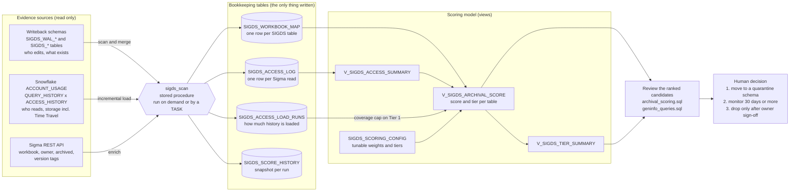
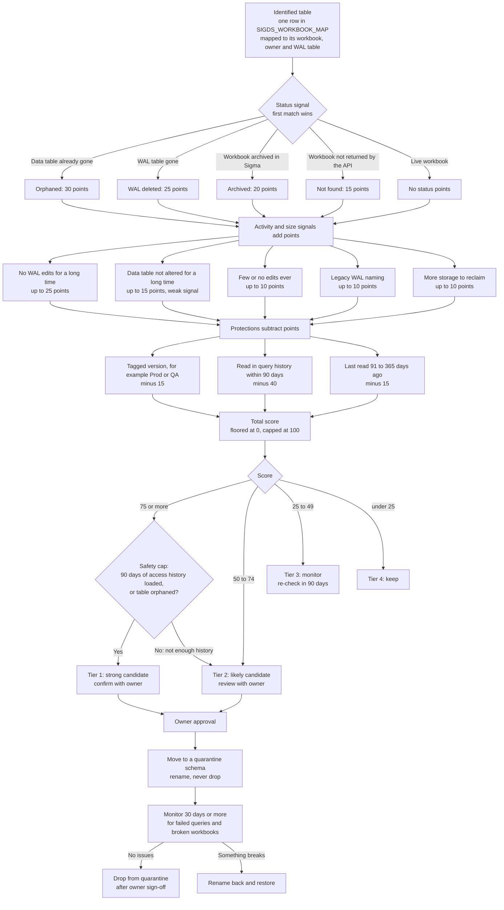

# writeback_info_sf

> **IN DEVELOPMENT — Do not use.** This toolkit is under active development. Content may be incomplete, incorrect, or subject to breaking changes without notice.
>
> **Test status.** Deployed and exercised end to end on a Snowflake Enterprise Edition account with a writeback schema of roughly 200 WAL tables, including the Sigma API enrichment. Behaviour on other accounts, editions and writeback volumes may differ, so run it first against a non-critical schema and review the output before relying on it. In particular, `API_NOT_FOUND` means "not visible to the Sigma API client you configured", which is not always the same as "deleted" (see [Known limitations](#known-limitations)).

A standalone, **read-only information tool** for Sigma writeback (input table) estates on Snowflake. It runs **entirely inside Snowflake** as a stored procedure — call it from a Snowsight worksheet or notebook, or schedule it with a task; nothing runs on your machine. It answers three questions about every `SIGDS_*` table:

1. **Whose is it?** — maps each WAL / data table to its Sigma workbook or data model, owner, folder, and archived / deleted state.
2. **Is anyone using it?** — combines the WAL (who *edits*) with Snowflake query history (who *reads*), so a table that is read all day but never edited is not mistaken for a dead one.
3. **What could be reclaimed?** — a transparent, tunable score and tier per table, plus reclaimable storage including Time Travel / Fail-safe.

It never drops, renames, or alters writeback tables. It does not depend on any other toolkit. The only elevated step is a **one-time ACCOUNTADMIN setup** (a network rule, secrets and an external access integration), which is what lets a Snowflake procedure call the Sigma API.

## Overview

When Sigma writebacks are enabled, Sigma creates a WAL table (`SIGDS_WAL_*`) and a data table (`SIGDS_*`) in Snowflake for each input table. Over time these accumulate — workbooks get archived or deleted, tables go stale, WAL records are orphaned. This toolkit gives administrators visibility into that state so cleanup can be planned safely.

### How it fits together



Reading it left to right: the scan gathers three kinds of evidence (edits, reads and Sigma metadata) into a handful of bookkeeping tables. The scoring views combine them under one set of tunable weights. Nothing in the pipeline changes a writeback table: any quarantine or drop is a separate, manual step taken by a person after reviewing the output.

### How a table is mapped to its workbook

The scan builds one row per writeback table in `SIGDS_WORKBOOK_MAP`. This is the identity half of the tool: which workbook and owner a table belongs to, and whether anything physical or in Sigma is missing. The [Decision logic](#decision-logic) diagram below picks up from the flags this produces.

```mermaid
flowchart TD

subgraph P1["PHASE 1 - Choose where to look"]
    S1["<b>Step 1: Take the writeback schemas you name</b><br/>Source: the SCAN_SCHEMAS parameter of sigds_scan<br/>How: one run covers one database and a list of schemas.<br/>Nothing is discovered from the Sigma API at this stage,<br/>so name every schema that holds Sigma writeback.<br/>Output: a list of database.schema locations to scan"]
end

subgraph P2["PHASE 2 - Inventory what is physically there"]
    S2["<b>Step 2: List the tables in each schema</b><br/>Source: Snowflake INFORMATION_SCHEMA.TABLES<br/>Captures name, created, last altered and bytes.<br/>Storage metrics add table id and Time Travel plus Fail-safe bytes<br/>when ACCOUNT_USAGE is readable, otherwise those stay empty."]
    S2A["<b>2a: WAL tables</b><br/>Tables named SIGDS_WAL*, matched by literal prefix,<br/>read in batches of 100.<br/>Legacy and newer naming are both recognised"]
    S2B["<b>2b: Data tables</b><br/>Writeback data tables are not listed on their own.<br/>Their names come from the WAL, so the listing is kept<br/>as a lookup by name for step 4.<br/>A data table with no WAL record is not discovered"]
end

subgraph P3["PHASE 3 - Read the WAL to learn who the table belongs to"]
    S3["<b>Step 3: Read the latest edit from each WAL table</b><br/>How: take the row with the highest EDIT_NUM for each tableName.<br/>Columns used: EDIT_NUM, DS_ID, TIMESTAMP, METADATA (JSON), EDIT (JSON).<br/>The highest EDIT_NUM stands in for the edit count.<br/>If two WALs cover one table, the one with the higher edit wins."]
    S3A["<b>3a: Parse the METADATA JSON</b><br/>tableName = the data table this WAL belongs to<br/>workbookId = the Sigma workbook<br/>sigmaUrl or workbookUrl = link, whose path carries the org slug<br/>elementTitle or inputTableTitle = the input table name<br/>userEmail = last editor"]
    S3B["<b>3b: Fall back to the EDIT JSON</b><br/>If userEmail is missing, read<br/>blameInfo.updatedBy from the updateRow or addRow edit"]
end

subgraph P4["PHASE 4 - Connect the WAL record to its data table"]
    S4["<b>Step 4: Look up the data table by name</b><br/>Join key: tableName from the WAL METADATA equals a table name in the same schema.<br/>Found: attach size, created, last altered, total bytes and table id.<br/>Not found: the data table is gone, so the row is flagged IS_ORPHANED.<br/>On later runs, a WAL table that has disappeared is flagged IS_DELETED,<br/>unless no WAL tables are visible at all, which points to a grants problem."]
end

subgraph P5["PHASE 5 - Resolve against Sigma's records"]
    S5["<b>Step 5: Look up the workbook and the people</b><br/>Source: Sigma API, using the credential in the Snowflake secrets<br/>How: one org-wide workbook list, plus data models, version tags and members.<br/>Match workbookId to the list. Only the org the API client belongs to is visible.<br/>Output: name, folder path, owner and display name, archived,<br/>tagged version and its parent, and not found.<br/>Not found is set for workbooks only, and only with an org-wide list"]
end

subgraph P6["PHASE 6 - Corroborate with query history"]
    S6["<b>Step 6: Find who really reads the table</b><br/>Source: Snowflake ACCOUNT_USAGE, QUERY_HISTORY joined to ACCESS_HISTORY<br/>Needs Enterprise Edition and an imported-privileges grant.<br/>How: Sigma appends a JSON comment to every query it generates.<br/>It holds the workbook URL and user email.<br/>Take SELECT and INSERT queries that touched the scanned schemas,<br/>tag each as READ or INSERT, and match to the map by table name.<br/>Loaded incrementally with an overlap window.<br/>Output: last read, last write, read counts, distinct users and source workbooks"]
end

subgraph P7["PHASE 7 - Record flags, then score"]
    S7["<b>Step 7: Flags in the map, evidence in the log</b><br/>IS_ORPHANED: the data table is gone.<br/>IS_DELETED: the WAL table is gone.<br/>API_IS_ARCHIVED and API_NOT_FOUND: the workbook state in Sigma.<br/>IS_TAGGED_VERSION: a Prod or QA version of a live workbook.<br/>Query history adds read evidence only. It never changes which workbook owns a table.<br/>The scoring views combine all of this, see Decision logic below.<br/>Tables are not yet classified by owning org"]
end

S1 --> S2
S2 --> S2A
S2 --> S2B
S2A --> S3
S3 --> S3A
S3 --> S3B
S3A --> S4
S3B --> S4
S2B --> S4
S4 --> S5
S5 --> S7
S1 -.->|"same schemas"| S6
S6 --> S7
```



## Files

Run them in this order, once; then just `CALL sigds_scan(...)` on a schedule.

| # | File | Purpose |
|---|---|---|
| 1 | `setup_prerequisites.sql` | **ACCOUNTADMIN, once.** Network rule (your Sigma host only), secrets for the Sigma URL + credentials, external access integration, grants. |
| 2 | `create_sigds_workbook_map.sql` | DDL: `SIGDS_WORKBOOK_MAP`, `SIGDS_ACCESS_LOG`, `SIGDS_ACCESS_LOAD_RUNS`, `SIGDS_SCORE_HISTORY`. Idempotent; upgrades pre-v2 maps in place. |
| 3 | `scoring_views.sql` | The scoring model, in **one place**: `SIGDS_SCORING_CONFIG` (tunable weights), `V_SIGDS_ACCESS_SUMMARY`, `V_SIGDS_ARCHIVAL_SCORE`, `V_SIGDS_TIER_SUMMARY`. Re-running keeps your config tuning. |
| 4 | `sigds_scan_procedure.sql` | The scan itself: `sigds_scan(...)` Python stored procedure, plus an example `TASK`. |
| — | `archival_scoring.sql` | Read-only queries over the scoring views, plus the safe-deletion procedure. |
| — | `geninfo_queries.sql` | Exploratory reports: landscape, reclamation, staleness, owners, multi-table workbooks, legacy WALs, read-only consumers, tier movement, quarantine watch. |

---

## Setup (once)

### Prerequisites

- A Snowflake database and schema to hold the tool's tables and procedure (the **map schema**). They must already exist. The role that will own the procedure (`<YOUR_ROLE>` below, e.g. `SYSADMIN`) needs `USAGE`, `CREATE TABLE`, `CREATE VIEW` and `CREATE PROCEDURE` on that schema.
- Access to `ACCOUNTADMIN` for step 1 only.
- A Sigma API client credential with **Admin** scope: *Administration → Developer Access → Create New* (the secret is shown once). Admin scope is what lets the tool list **every** workbook in the org (`skipPermissionCheck`); without it, "workbook not found" cannot be trusted and the tool turns that signal off for the run. [Docs](https://help.sigmacomputing.com/reference/generate-client-credentials).
- **Recommended — for access evidence:** Snowflake **Enterprise Edition** or higher. Step 1 grants `IMPORTED PRIVILEGES ON DATABASE SNOWFLAKE` to your role, which unlocks `ACCOUNT_USAGE.ACCESS_HISTORY` / `QUERY_HISTORY` (who reads and writes each table) and `TABLE_STORAGE_METRICS` (Time Travel / Fail-safe bytes). Without it the tool still works, but scores reflect **writes only** and nothing can reach TIER 1 (see [Access evidence](#access-evidence-and-the-safety-cap)).

### Your Sigma API host

| Cloud / Region | Host (no `https://`) |
|---|---|
| AWS US (West) | `aws-api.sigmacomputing.com` |
| AWS US (East) | `api.us-a.aws.sigmacomputing.com` |
| AWS EU | `api.eu.aws.sigmacomputing.com` |
| AWS UK | `api.uk.aws.sigmacomputing.com` |
| AWS CA | `api.ca.aws.sigmacomputing.com` |
| AWS AU / APAC | `api.au.aws.sigmacomputing.com` |
| Azure US | `api.us.azure.sigmacomputing.com` |
| Azure EU | `api.eu.azure.sigmacomputing.com` |
| GCP US | `api.sigmacomputing.com` |

### Deploy — in a Snowsight worksheet

For each of the four files: open it, **find & replace** the placeholders, paste into a Snowsight worksheet, and **Run All**. (Snowsight: Cmd/Ctrl+F opens find, with a replace option.)

| Placeholder | Meaning | Files |
|---|---|---|
| `<YOUR_DATABASE>` | Database holding the tool's tables + procedure | 1, 2, 3, 4 |
| `<YOUR_SCHEMA>` | The map schema | 1, 2, 3, 4 |
| `<YOUR_ROLE>` | Role that will own and run the procedure | 1 |
| `<YOUR_SIGMA_API_HOST>` | From the table above | 1 |
| `<YOUR_SIGMA_CLIENT_ID>` / `<YOUR_SIGMA_CLIENT_SECRET>` | Sigma API credential | 1 |
| `<YOUR_WAREHOUSE>` | Only if you enable the example `TASK` | 4 |

1. **`setup_prerequisites.sql`** — runs as `ACCOUNTADMIN` (the file switches role itself). Also uncomment and edit the writeback-schema `GRANT`s at the bottom so your role can read the schema(s) you'll scan.
2. **`create_sigds_workbook_map.sql`** — run as your role.
3. **`scoring_views.sql`** — run as your role.
4. **`sigds_scan_procedure.sql`** — run as your role (the role that was granted the integration and secrets in step 1).

Everything is idempotent, so re-running a file is safe. The Sigma client secret passes through Snowflake query history once, in step 1 (inherent to `CREATE SECRET`); rotate it afterwards if that matters.

### Run it

In a worksheet (or a Snowsight notebook SQL cell), as the role that holds the setup grants (the procedure runs with the **caller's** rights). **Always pass `MAP_DATABASE` and `MAP_SCHEMA` explicitly:**

```sql
-- CALL sigds_scan(<writeback db>, <writeback schema(s), comma-separated>, <map schema>, <map db>);
CALL sigds_scan('WB_DB', 'WRITEBACK', 'INFO', 'TOOL_DB');
CALL sigds_scan('WB_DB', 'PROD_WB,DEV_WB', 'INFO', 'TOOL_DB');       -- several writeback schemas, one run
CALL sigds_scan('WB_DB', 'WRITEBACK', 'INFO', 'TOOL_DB', TRUE);      -- skip the query-history load
```

| Parameter | Default | Meaning |
|---|---|---|
| `WB_DATABASE` | required | Database containing the writeback schema(s). |
| `SCAN_SCHEMAS` | required | Comma-separated writeback schemas to scan. |
| `MAP_SCHEMA` | caller's current schema | Schema holding the map/log tables — pass it explicitly. |
| `MAP_DATABASE` | `WB_DATABASE` | Database holding the map/log tables. Usually **not** the writeback database — pass it explicitly. |
| `SKIP_ACCESS_LOG` | `FALSE` | Skip the query-history load (e.g. grant not in place yet). |
| `BACKFILL_DAYS` | `90` | First access-log load look-back (QUERY_HISTORY keeps 365). |
| `OVERLAP_HOURS` | `12` | Re-scan buffer for ACCESS_HISTORY latency (~3 h). |
| `MAX_WAL_TABLES` | `0` (all) | Cap WAL tables for testing; disables deletion detection. |

Database and schema names are treated as unquoted (upper-cased) identifiers. The call **returns the run log as text** — read it in the result pane: Sigma API counts → per-schema WAL/MERGE counts → enrichment counts → access-log window (or a `SKIPPED` reason) → score snapshot and a tier summary.

The first run backfills 90 days of query history, which can be heavy on a busy account — use a larger warehouse for it; later runs are incremental and small.

**Schedule it** (optional): an example `CREATE TASK` is at the bottom of `sigds_scan_procedure.sql` (grant `EXECUTE TASK` first — it's commented in the setup file). Daily or weekly works; score history only becomes useful with more than one snapshot.

### Then look at the results

Open `archival_scoring.sql` and `geninfo_queries.sql`, replace the placeholders, and run them in Snowsight:

| Placeholder | Where | Replace with |
|---|---|---|
| `<YOUR_DATABASE>` | both files | your database |
| `<YOUR_SCHEMA>` | both files | your map schema |
| `<WRITEBACK_SCHEMA>` | `geninfo_queries.sql`, query 10 only | the writeback schema you quarantined tables from |

Start with `archival_scoring.sql` query 3 (is access evidence loaded?), then query 2 (tier summary), then query 1 (ranked candidates).

### If something goes wrong

| Symptom | Likely cause |
|---|---|
| `Bookkeeping tables not found …` | Files 2/3 haven't been run in that database/schema, or `MAP_DATABASE` / `MAP_SCHEMA` point elsewhere. |
| `Integration … does not exist or not authorized`, or a secret/network error when creating the procedure | Step 1 not run, or your role lacks `USAGE` on the integration / `READ` on the three secrets. |
| `Failed to connect` / host errors from the Sigma API | The host in `setup_prerequisites.sql` doesn't match your Sigma region, or the network rule/secret has a typo. |
| `SKIPPED: cannot read … ACCESS_HISTORY` | Not Enterprise Edition, or the `IMPORTED PRIVILEGES` grant is missing for the role calling the procedure. The rest still works; scores are write-only and TIER 1 is capped. |
| `WARN: org-wide workbook list refused` | The Sigma credential isn't Admin scope. Enrichment still runs but `API_NOT_FOUND` is off for the run. |
| `WARN: no WAL tables visible but N previously known` | The calling role lost `USAGE`/`SELECT` on the writeback schema. Nothing was flagged deleted. |
| `Discovered 0 WAL table(s)` on a first run | Wrong schema name in `SCAN_SCHEMAS`, or the calling role can't see that schema. |

---

## How a run works

1. **Scan each schema** — discovers `SIGDS_WAL_*` tables from `INFORMATION_SCHEMA.TABLES`, reads the latest WAL entry per SIGDS table (batched `UNION ALL`, 100 tables per query), attaches physical metadata (size, created, last altered; Time Travel + Fail-safe from `TABLE_STORAGE_METRICS` when readable), and MERGEs into `SIGDS_WORKBOOK_MAP`.
   **Every row is refreshed on every run.** (The pre-v2 script only updated rows whose WAL edit number had grown, so size, owner, and archive state silently froze.)
2. **Flag what vanished** — WAL tables gone from the schema → `IS_DELETED`; SIGDS data tables gone → `IS_ORPHANED`. If *zero* WAL tables are visible but some were known, the tool refuses to flag deletions (almost certainly a grants problem, not a mass deletion).
3. **Enrich from Sigma** — one fetch of workbooks (org-wide), data models, version tags, and members; then refresh name, path, owner, archived state, and tagged-version status for **every** known `WORKBOOK_ID`. A workbook the API no longer returns is flagged `API_NOT_FOUND` (previously this could only fire for IDs that had *never* been enriched). Not set for data models — their API list is visibility-scoped.
4. **Load the access log** — see below.
5. **Snapshot scores** into `SIGDS_SCORE_HISTORY` and print a tier summary.

### Access evidence and the safety cap

Sigma appends a JSON comment (`-- Sigma Σ {...}`) to every warehouse query it generates, carrying the source workbook URL and the acting user's email. The tool joins `QUERY_HISTORY` × `ACCESS_HISTORY`, keeps those queries that touched a scanned writeback schema, and lands one row per (query, table, `READ`/`INSERT`) in `SIGDS_ACCESS_LOG`.

> **In practice this is read evidence.** In testing, Sigma's writeback statements arrived as `MERGE`s that carry **no** Sigma comment, so the `INSERT` branch captured nothing and `ACCESS_WRITE_COUNT` / `ACCESS_LAST_WRITE_AT` stay empty. That is fine for scoring — **writes are seen through the WAL** (`WAL_LAST_EDIT_AT`), and query history supplies the half the WAL cannot: **reads**. Don't read a zero write count as "never written".

> **Where the access evidence lives.** It is deliberately **not** stored in `SIGDS_WORKBOOK_MAP`: access figures are windowed (a count of 23 means little without knowing whether the log covers 7 or 90 days) and a copy in the map could drift from the log. Query **`V_SIGDS_ARCHIVAL_SCORE`** for the combined picture (map + access summary + score), or `V_SIGDS_ACCESS_SUMMARY` for the per-table access roll-up (last read, read/write counts, distinct users and source workbooks, last source URL).

This matters because the WAL only records *edits*. An input table that dashboards read daily but nobody edits looks abandoned from the WAL alone; query history shows it is live. In scoring, recent access applies a large penalty, and **absence of access is never treated as proof of abandonment** — it just removes a protection.

Each row carries `ACCESS_EVIDENCE`:

| Value | Meaning |
|---|---|
| `RECENT` | Read/written within `ACCESS_RECENT_DAYS` (90) — large penalty |
| `OLDER` | Last access within `ACCESS_OLDER_DAYS` (365) — small penalty |
| `NONE_IN_WINDOW` | Log loaded, nothing seen — no penalty |
| `NOT_LOADED` | Access log never loaded — **score reflects writes only** |

**Coverage cap:** until `SIGDS_ACCESS_LOAD_RUNS` shows successfully-loaded history covering `MIN_ACCESS_COVERAGE_DAYS` (default 90), no table can reach TIER 1 ("quarantine now") — it is held at TIER 2 with an explanatory `SCORE_NOTE`. (Already-`IS_ORPHANED` rows are exempt; their data table is gone, so there is nothing left to break.) Coverage is derived from the loader's own run log, not from the log's earliest row, because a table nobody touched leaves no rows to prove how long it has been watched.

**Caveats:** `ACCESS_HISTORY` lags up to ~3 h (hence the overlap window); `ACCOUNT_USAGE` retains 365 days (the log keeps accumulating beyond that); it only sees the **Snowflake account the tool runs in** — writeback by another account is invisible; and only `SELECT` / `INSERT` statements carrying Sigma's comment are captured (see the note above on writes). Reads by tools other than Sigma are not attributed.

### What changed from v1

| | v1 | v2 |
|---|---|---|
| Activity signal | WAL edits only | WAL edits **+ query-history reads/writes** |
| Row refresh | Only rows with a higher WAL edit number | Every row, every run |
| "Workbook deleted" detection | Only never-enriched IDs | Every known ID, every run (`API_NOT_FOUND`) |
| Owner / name / path | Set once, never refreshed | Refreshed every run |
| Scoring logic | Copy-pasted in two places | One view, weights in `SIGDS_SCORING_CONFIG` |
| History | Overwritten in place | `SIGDS_SCORE_HISTORY` snapshot per run |
| Storage | Active bytes of the data table | Data table incl. Time Travel/Fail-safe + WAL table |
| Runs where | A Python script on your machine | A Snowflake stored procedure (`sigds_scan`) — schedulable with a task |
| Credentials | Plaintext constants in the script | Snowflake `SECRET` objects |
| Schemas | Edit the script, re-run per schema | `SCAN_SCHEMAS => 'A,B,C'` |
| Setup | Edit placeholders in the script and SQL | Find & replace placeholders, run four SQL files |

---

## SIGDS_WORKBOOK_MAP — key columns

Prefixes show the data source:
- **`WAL_`** — WAL row data or WAL table metadata
- **`SIGDS_`** — `INFORMATION_SCHEMA` / storage metrics for the writeback data table
- **`API_`** — Sigma REST API

| Column | Description |
|---|---|
| `SIGDS_TABLE`, `SCAN_SCHEMA` | Composite primary key |
| `WAL_TABLE_FQN` | Fully-qualified WAL table name |
| `WAL_DS_ID`, `WAL_WORKBOOK_URL`, `WAL_INPUT_TABLE_NAME` | From the latest WAL record |
| `WAL_LAST_EDIT_AT` / `_BY` / `WAL_MAX_EDIT_NUM` | Latest WAL edit time, editor, highest edit number |
| `WAL_TABLE_LAST_MODIFIED`, `WAL_TABLE_SIZE_BYTES` | WAL table `LAST_ALTERED` and active bytes |
| `SIGDS_TABLE_CREATED_AT` / `_LAST_MODIFIED` | From `INFORMATION_SCHEMA.TABLES` (`LAST_ALTERED` tracks DDL, not edits) |
| `SIGDS_TABLE_ID` | `ACCOUNT_USAGE.TABLE_STORAGE_METRICS.ID` (NULL if unreadable or table too new) |
| `SIGDS_TABLE_SIZE_BYTES` | Active bytes |
| `SIGDS_TABLE_TOTAL_BYTES` | Active + Time Travel + Fail-safe (NULL if `ACCOUNT_USAGE` unreadable) |
| `WORKBOOK_ID` / `_NAME` / `_PATH`, `OBJECT_TYPE` | Sigma workbook or data model (`WORKBOOK` / `DATA_MODEL`) |
| `ORG_SLUG` | Org slug parsed from the WAL workbook URL |
| `IS_ORPHANED` | SIGDS data table no longer exists |
| `IS_DELETED` / `DELETED_AT` | WAL table gone from the schema (auto-cleared if it reappears) |
| `IS_LEGACY_WAL` | Old `SIGDS_WAL_<uuid>` naming |
| `IS_TAGGED_VERSION`, `VERSION_TAG_NAME`, `PARENT_WORKBOOK_ID` | Version-tag (Prod/QA) resolution |
| `API_OWNER_ID` / `_FIRST_NAME` / `_LAST_NAME` | Owner, refreshed each run |
| `API_IS_ARCHIVED` | Archived in Sigma, refreshed each run |
| `API_NOT_FOUND` | Not returned by the API on the latest run (workbooks only) |
| `API_LAST_SEEN_AT`, `LAST_SCANNED_AT` | Last API sighting / last scan (UTC) |

Access data lives in `SIGDS_ACCESS_LOG` and is rolled up by `V_SIGDS_ACCESS_SUMMARY` (last read, last write, counts, distinct users, last source workbook URL and user).

---

## Scoring

All logic is in `V_SIGDS_ARCHIVAL_SCORE` (`scoring_views.sql`). Weights, bands, tier cut-offs, and the access penalty are **rows in `SIGDS_SCORING_CONFIG`** — tune with `UPDATE`, no SQL edits:

```sql
UPDATE SIGDS_SCORING_CONFIG SET WAL_DAYS_1 = 540, TIER1_MIN = 80 WHERE CONFIG_ID = 1;
```

### Decision logic

How one table moves from "identified" to a tier and a recommended action. Every number below is a default that lives in `SIGDS_SCORING_CONFIG`.



Three things the diagram makes explicit:
- **Nothing is excluded outright.** Protections reduce the score rather than removing a table from consideration, so a heavily-read or tagged table can still appear, just in a lower tier.
- **Status is one signal, not a gate.** An archived or not-found workbook adds points but does not by itself make a table a candidate; recent reads can still outweigh it.
- **Everything after the tier is manual.** The tool stops at the ranked list. Approval, quarantine and any drop are taken by a person.

### Model (positive components total 100; higher = stronger archival candidate)

| Dimension | Max | Logic (defaults) |
|---|---|---|
| Status | 30 | orphaned 30 / WAL deleted 25 / workbook archived 20 / workbook not in API 15 |
| WAL edit recency | 25 | >365 d or never → 25 / >180 → 18 / >90 → 10 / >30 → 4 |
| SIGDS table altered | 15 | >365 d → 15 / >180 → 10 / >90 → 5 (weak: `LAST_ALTERED` is DDL) |
| Edit volume | 10 | 0 → 10 / ≤10 → 8 / ≤50 → 5 / ≤200 → 2 (calibrate to your org) |
| Legacy WAL | 10 | legacy & active (<180 d) → 10 / legacy & inactive → 5 |
| Storage | 10 | >1 GB → 10 / >100 MB → 7 / >10 MB → 4 / else 1 |

| Penalty | Default |
|---|---|
| Tagged version (Prod/QA) | −15 |
| Access within 90 days (`RECENT`) | **−40** |
| Last access 91–365 days (`OLDER`) | −15 |

Score is floored at 0 and capped at 100.

### Tiers

| Score | Tier | Recommendation |
|---|---|---|
| ≥ 75 | **TIER 1** | Strong candidate — quarantine now *(only once access coverage ≥ 90 days)* |
| 50–74 | **TIER 2** | Likely candidate — review with owner |
| 25–49 | **TIER 3** | Monitor — check in 90 days |
| < 25 | **TIER 4** | Keep — active or protected |

> **Important — read before taking any action based on these scores.**
>
> The weights and tiers are entirely subjective. What counts as an appropriate threshold varies significantly from customer to customer. Scores are a starting point for investigation, not a directive. Note too that this tool cannot see readers outside the Snowflake account it runs in, or anything not issued by Sigma.
>
> **Incorrectly removing a SIGDS table or its WAL table can cause irreparable impact to the related Sigma content.** Always follow the safe deletion process below and have the workbook owner approve before any action.

## Analysis queries (`geninfo_queries.sql`)

| Query | What it shows |
|---|---|
| 1. Landscape overview | Per-schema totals: orphaned / deleted / archived counts, total and reclaimable GB |
| 2. Storage reclamation opportunity | Tables with a clear archival signal, ranked by size |
| 3. Active workbooks going stale | Inactivity bands (31–90 / 91–180 / 181–365 / >365 days) |
| 4. Most active writeback tables | Highest edit volume — the inverse view; business-critical tables |
| 5. Owner accountability | Cleanup burden per workbook owner |
| 6. Workbooks with multiple input tables | Resolves tagged versions to their parent workbook |
| 7. Legacy WAL inventory | `SIGDS_WAL_<uuid>` tables, active (urgent) vs inactive |
| 8. Read-only consumers | **New.** Live tables with recent reads but no recent edits — the false positives a write-only view would produce |
| 9. Tier movement | **New.** Tables whose tier changed since the previous run |
| 10. Quarantine watch | **New.** Failed Sigma queries (error 2003) against SIGDS names during a quarantine period |

---

## Safe Deletion of SIGDS and WAL Tables

> **Best practice: move first, delete later — never drop directly.** This tool reports; it does not remediate.

Sigma stores the exact fully-qualified name of both the SIGDS data table and the WAL table in its metadata. If either is dropped or renamed, workbooks fail immediately.

1. **Identify candidates** with `archival_scoring.sql`. Prefer TIER 1/2 rows whose `ACCESS_EVIDENCE` is `NONE_IN_WINDOW`, and check `SCORE_NOTE`.
2. **Move** *both* the SIGDS and WAL tables to a quarantine schema:
   ```sql
   ALTER TABLE <DATABASE>.<SCHEMA>.<TABLE>
     RENAME TO <DATABASE>.<SCHEMA>_QUARANTINE.<TABLE>;
   ```
3. **Monitor ≥ 30 days.** Run `geninfo_queries.sql` query 10 — any failed Sigma query against a moved name means something still depended on it: rename it straight back.
4. **Drop** from quarantine only after a clean period and owner sign-off.

Recovery is simple when a table was moved rather than dropped — rename it back and the workbook resumes. A direct `DROP TABLE` is irreversible.

## Known limitations

- **`API_NOT_FOUND` means "not visible to this API client", not necessarily "deleted".** The Sigma API only lists workbooks in the org the client belongs to. If the writeback schema receives writes from more than one Sigma org (check the org slug in `SIGDS_ACCESS_LOG.SIGMA_SOURCE_URL` and `ORG_SLUG` in the map), workbooks from the other orgs resolve as not found. Compare those org slugs with your API client's org before treating not-found tables as deletion candidates; the recent-read and recent-edit protections in the score still apply. The scan does not yet separate cross-org tables automatically.
- Access evidence needs Enterprise Edition + `IMPORTED PRIVILEGES`; single Snowflake account only; it is effectively read evidence (writes come from the WAL); relies on Sigma's query-comment format.
- A SIGDS data table with **no WAL record** is invisible to the scan (discovery is WAL-driven). The tool's own `SIGDS_*` tables are not confused with writeback tables, for the same reason.
- The procedure runs with the **caller's** rights, so the calling role needs every grant from the setup file.
- A data model missing from the Sigma API is never flagged `API_NOT_FOUND` (its list is visibility-scoped), and a non-admin token disables the signal for workbooks too.
- Changing the casing of `SCAN_SCHEMAS` between runs creates separate rows (names are upper-cased; pre-v2 rows stored with a different case will not merge).
- Writeback to Databricks is out of scope here — see `writeback_info_dbx`.
